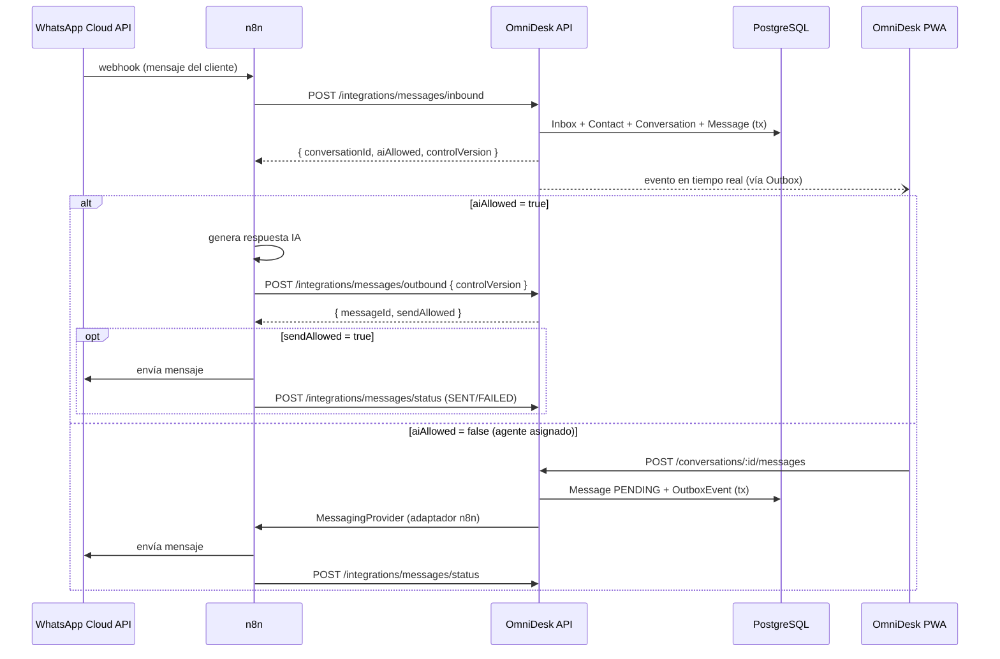
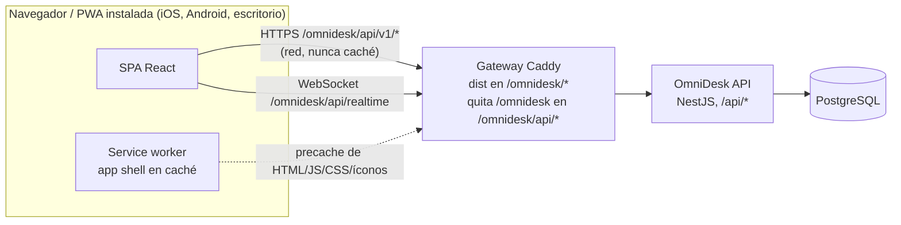

# OmniDesk — Arquitectura y plan MVP incremental

> **Versión:** 0.5
> **Fecha:** 2026-10-12
> **Sustituye a:** `OmniDesk_Plan_MVP_Arquitectura.docx` (v0.1, 2026-10-11), que queda como histórico.
> **Estado:** documento base de planificación. Cada incremento se detalla en su propio spec dentro de `specs/` antes de implementarse.

Plataforma SaaS multiempresa para supervisar conversaciones atendidas por IA y por agentes humanos. Ofrece historial unificado y una aplicación web instalable (PWA).

---

## 0. Historial de cambios

### v0.5 (respecto a v0.4)

| # | Cambio | Motivo |
| --- | --- | --- |
| 1 | El despliegue pasa de Railway a un **VPS propio con Docker Compose** y dos entornos aislados (`omnidesk-dev`, `omnidesk-prod`). | Decisión del equipo (SPEC 08). Con VPS y dominio propios, Railway no aporta y sus dominios `*.up.railway.app` rompen la cookie entre `app` y `api` (Public Suffix List). |
| 2 | La web y el API se sirven en el **mismo origen bajo la subruta `/omnidesk`** (`https://<dominio>/omnidesk` y `/omnidesk/api`), detrás del Nginx existente. Local también usa `/omnidesk`. | El dominio ya sirve otro sitio en la raíz. Mismo origen: sin CORS entre orígenes y cookie de un solo origen (también en iOS standalone). |

### v0.4 (respecto a v0.3)

| # | Cambio | Motivo |
| --- | --- | --- |
| 1 | Se **reordena el roadmap**: la bandeja (ingesta + supervisión de solo lectura) pasa antes que identidad, y el tiempo real se separa en su propio incremento. | Tener funcionalidad del producto visible cuanto antes (SPEC 02). |
| 2 | `Message` vive en el módulo `conversations`, no en `messaging`. | La `sequence` exige bloquear la conversación en la misma transacción. `messaging` queda para el puerto `MessagingProvider`. |
| 3 | Nuevo módulo `demo`: tenant demo sembrado al arrancar y lectura sin login, solo con `DEMO_MODE=true` (prohibido en producción). | Ver la bandeja antes de que exista el login, sin abrir datos personales. |
| 4 | Nuevo paquete `tools/simulator` (`pnpm simulate`). | Ejercita los contratos de integración reales sin depender de n8n. |

### v0.3 (respecto a v0.2)

| # | Cambio | Motivo |
| --- | --- | --- |
| 1 | La web y el API se **separan como aplicaciones desplegables independientes** dentro del mismo monorepo. El navegador llama al API directamente por HTTP; no hay servidor de frontend intermedio. | La app web debe poder instalarse en móviles como página web (PWA) y evolucionar y desplegarse sin depender del backend. |
| 2 | El frontend pasa de **Next.js a Vite + React SPA** (React Router, TanStack Query y `vite-plugin-pwa`). | Es un panel tras login: no necesita SSR ni SEO. Una SPA estática se sirve desde cualquier CDN y es la forma más directa de una PWA instalable. |
| 3 | La **instalabilidad PWA** (manifest, íconos, service worker, prompt de instalación) pasa del incremento 7 al **incremento 0**. | Lo instalable es una propiedad de la arquitectura desde el inicio, no un pulido final. |
| 4 | Se añade **Caddy** como gateway local de mismo origen (`/api/*` → API, resto → web) y un **túnel HTTPS opcional** (cloudflared) para instalar la PWA en un celular real. | Un celular solo instala una PWA desde HTTPS. |
| 5 | El API añade **CORS con lista blanca** (`CORS_ORIGINS`). Se define la topología de producción (§4.3). | La web y el API pueden vivir en orígenes distintos. |
| 6 | Se resuelve el pendiente de sesión OAuth: **Passport en NestJS con cookie `httpOnly`**. | Al eliminar el servidor Next.js, la opción Auth.js deja de aplicar. |

### v0.2 (respecto a v0.1)

| # | Cambio | Motivo |
| --- | --- | --- |
| 1 | Nuevo **Incremento 0 — Walking skeleton local** con Docker Compose. | Cada incremento posterior nace desplegable y verificable. |
| 2 | Railway pasa a un incremento propio de **despliegue**. El desarrollo empieza 100 % local. | Decisión del equipo: iniciar con Docker Compose y PostgreSQL local. |
| 3 | Nueva sección **Principios de arquitectura**: hexagonal por módulo, contratos compartidos, Outbox e Inbox. | La v0.1 nombraba Ports & Adapters solo para n8n. Se generaliza a todo el backend. |
| 4 | Nuevo **protocolo de control de IA** con `controlVersion`. La IA registra su respuesta **antes** de enviarla. | Cierra la carrera "respuesta IA tardía tras asignación" (v0.1 §9 y §14). |
| 5 | Los comandos de conversación pasan de `PATCH` a `POST /:id/<comando>`. Se añaden `close` y `reopen`. | Son acciones con efectos y eventos, no actualizaciones parciales. Admiten `Idempotency-Key`. |
| 6 | Nueva entidad `OutboxEvent` y nuevos campos en `Conversation` y `Message`: `controlVersion`, `sequence`, `lastSequence`. | Fiabilidad de eventos en tiempo real y de envíos, más orden estable del historial. |
| 7 | Se resuelven con **decisiones por defecto** los pendientes de v0.1 §14 sobre cierre/reapertura, visibilidad y multimedia. | Desbloquea los incrementos 2–4. Cada spec puede revisarlas. |
| 8 | Nueva estructura de repositorio: monorepo pnpm + Turborepo y paquete `@omnidesk/contracts`. | Un solo contrato tipado para API, PWA e integraciones. |

---

## 1. Objetivo y alcance

OmniDesk centraliza y muestra en tiempo real todas las interacciones de los clientes con una empresa. Eso incluye los mensajes recibidos, las respuestas de la IA y las respuestas de los agentes humanos.

Los usuarios autorizados asignan conversaciones a agentes para que estos tomen el control de la atención. La IA **no** decide cuándo transferir una conversación: la asignación humana siempre se hace desde OmniDesk.

## 2. Principios de producto

- **Multiempresa (multi-tenant):** los datos y los permisos están aislados por empresa.
- **Historial único:** cada conversación tiene un historial cronológico único con los mensajes del cliente, de la IA y de los agentes, más los eventos operativos.
- **IA por defecto:** las conversaciones nuevas no tienen agente asignado y las atiende la IA.
- **Asignar apaga la IA:** asignar una conversación a un agente detiene las respuestas automáticas en esa conversación.
- **Supervisión pasiva:** un usuario puede supervisar conversaciones de la IA sin intervenir.
- **n8n es reemplazable:** n8n es la primera integración, no una dependencia permanente. Se podrá sustituir por un servicio propio de recepción, orquestación de IA y envío.

## 3. Principios de arquitectura

1. **Monolito modular.** Un único despliegue de backend (NestJS) dividido en módulos con fronteras explícitas. Los módulos se comunican a través de servicios de aplicación exportados o de eventos de dominio. Nunca importan la infraestructura de otro módulo.
2. **Hexagonal dentro de cada módulo.** Cada módulo tiene tres capas:
   - `domain/`: TypeScript puro, sin frameworks ni ORM.
   - `application/`: casos de uso y puertos (interfaces más tokens de inyección).
   - `infrastructure/`: controladores HTTP, gateways, adaptadores y repositorios Prisma.

   ESLint hace cumplir estas reglas de dependencia (ver §6).
3. **Contratos primero.** Los esquemas de entrada y salida (zod) viven en `@omnidesk/contracts`. Los consumen el API, la PWA y las pruebas de integración. OpenAPI se genera a partir de ellos.
4. **Ports & Adapters para proveedores externos.** El envío saliente pasa por el puerto `MessagingProvider`. La recepción pasa por normalizadores `InboundEventNormalizer` por proveedor. El dominio no conoce n8n ni WhatsApp.
5. **Fiabilidad por patrones.**
   - **Inbox:** se deduplican los eventos externos por `(source, externalId)`.
   - **Outbox transaccional:** el cambio de estado y el evento que hay que emitir se guardan en la misma transacción. Un dispatcher los publica después, en Socket.IO o en el proveedor, con reintentos.
   - **Idempotency keys** en los comandos que llegan del cliente y de las integraciones.
6. **Aislamiento por tenant en el servidor.** El tenant se obtiene siempre de la sesión o de la credencial de integración, nunca del cuerpo de la petición. Todas las tablas de negocio llevan `tenantId`.
7. **Incrementos verticales.** Cada incremento atraviesa todas las capas que necesita (DB → API → PWA). Al cerrarse, el sistema queda ejecutable.
8. **Web y API desacoplados.**
   - La PWA es una SPA estática: HTML, JS y CSS, sin servidor propio.
   - Se comunica con el API solo por HTTP/WebSocket, usando los contratos de `@omnidesk/contracts`.
   - Cada una se construye, versiona y despliega por separado. La web solo conoce la URL base del API (`VITE_API_URL`).
   - El API no sirve archivos de la web ni conoce sus rutas.

## 4. Arquitectura lógica

### 4.1 Flujo inicial (con n8n)



### 4.2 Flujo futuro

`WhatsApp Cloud API → Custom AI Service (webhook, reglas, modelo, envío) ↔ OmniDesk API ↔ PWA`

Los contratos de OmniDesk se mantienen estables, así el motor se puede reemplazar sin reescribir la interfaz. El servicio propio será un nuevo adaptador de `MessagingProvider` y un nuevo `InboundEventNormalizer`, configurables por canal.

### 4.3 Topología de la web y el API



La app vive bajo la subruta `BASE_PATH=/omnidesk` en todos los entornos. La web la conoce en el build (`base` de Vite, `basename` del router, `scope` y `start_url` del manifest, `navigateFallback` de Workbox). El API sigue sirviendo `/api/*`: el gateway quita el prefijo, y el API solo usa `PUBLIC_BASE_PATH` para la ruta de la cookie (`Path=/omnidesk`) y las URL públicas (`APP_URL`, callback de OAuth).

**Local (incremento 0):**

- Caddy publica un único origen en `http://localhost:8080`: `/omnidesk/api/*` va al API (sin el prefijo), `/omnidesk/*` a Vite y `/` redirige a `/omnidesk/`.
- `localhost` ya es un contexto seguro, así que la PWA se instala en escritorio sin certificados.
- Para instalarla en un celular, el profile `tunnel` (cloudflared) expone ese mismo origen por una URL HTTPS pública temporal.

**Producción** (SPEC 08, guía en `docs/despliegue.md`):

- Un VPS propio con dos proyectos Compose aislados (red, volumen y backups propios): `omnidesk-dev` en `https://dev.gastromesa.com/omnidesk` y `omnidesk-prod` en `https://gastromesa.com/omnidesk`.
- El Nginx existente termina TLS y reenvía `/omnidesk/*`, sin quitar el prefijo, al gateway del entorno en `127.0.0.1` (8081 dev, 8082 prod). Pasa el upgrade del WebSocket.
- El gateway (imagen `infra/gateway`) es Caddy con el build de la web y el proxy al API, con cabeceras de caché (`no-cache` para `index.html`, `sw.js` y el manifest; `immutable` para `assets/`) y una CSP estricta (`default-src 'self'`).
- Web y API en el mismo origen: la web se compila con `VITE_API_URL` vacía, la cookie es de un solo origen y no hay CORS entre orígenes.
- El API corre como usuario no root, aplica `prisma migrate deploy` antes de aceptar peticiones y confía en dos proxies (`TRUST_PROXY=2`).
- Postgres en contenedor sin puertos publicados, con `pg_dump` diario a las 03:00 y 7 copias por entorno.

**Reglas del service worker:**

- Precarga solo el app shell (HTML, JS, CSS, íconos).
- `navigateFallback` a `/omnidesk/index.html`, excepto en `/omnidesk/api/*`. El `scope` es `/omnidesk/`.
- Nunca cachea respuestas del API: los datos de conversaciones siempre vienen de la red.
- Cuando hay una versión nueva, la app muestra "Nueva versión disponible" y no recarga sola, para no interrumpir a un agente mientras escribe.

## 5. Stack

| Capa | Elección |
| --- | --- |
| Monorepo | pnpm workspaces + Turborepo |
| Frontend / PWA | Vite + React SPA, TypeScript, React Router, TanStack Query, Tailwind CSS, shadcn/ui, `vite-plugin-pwa` (Workbox) |
| Backend | NestJS, TypeScript (monolito modular, hexagonal por módulo) |
| Contratos | zod en `@omnidesk/contracts`; OpenAPI generado (Swagger en `/api/docs`) |
| Datos | PostgreSQL, Prisma |
| Autenticación | Google OAuth; invitaciones y membresías por empresa |
| Tiempo real | Socket.IO con autorización por tenant y rooms por tenant/conversación |
| Observabilidad base | Logs JSON con pino y `x-request-id` propagado |
| Pruebas | Vitest (unitarias e integración), supertest (e2e del API), Playwright (E2E de la PWA, incremento 7) |
| Entorno local | Docker Compose: `postgres`, `api`, `web` y `caddy` (gateway de mismo origen); profiles `pwa` (build + preview) y `tunnel` (cloudflared, HTTPS para móvil) |
| Integración inicial | n8n + WhatsApp Cloud API |
| Despliegue | VPS propio con Docker Compose (dev y prod), detrás del Nginx existente, bajo `/omnidesk`; despliegue manual con `infra/deploy/deploy.sh` (SPEC 08) |
| Evolución | Redis (adapter de Socket.IO y colas) cuando haya más de una instancia, almacenamiento de archivos, servicio de IA propio |

## 6. Estructura del repositorio

```text
omnidesk/
├── apps/
│   ├── api/                      # NestJS
│   │   ├── prisma/               # schema.prisma + migraciones
│   │   ├── src/
│   │   │   ├── modules/<modulo>/
│   │   │   │   ├── domain/
│   │   │   │   ├── application/
│   │   │   │   └── infrastructure/
│   │   │   └── shared/           # config, kernel, infraestructura transversal
│   │   └── test/                 # e2e
│   └── web/                      # Vite + React SPA instalable (PWA)
│       ├── public/               # logo.svg e íconos generados
│       └── src/
│           ├── app/              # router, providers
│           ├── pages/
│           ├── features/<feature>/{api,model,ui}
│           └── shared/           # config, cliente HTTP, PWA
├── packages/
│   ├── contracts/                # esquemas zod + tipos compartidos
│   ├── tsconfig/                 # configuraciones TS base
│   └── eslint-config/            # reglas, incluidas las de límites entre capas
├── infra/caddy/Caddyfile         # gateway local de mismo origen
├── docs/arquitectura.md          # este documento
├── specs/                        # un spec por incremento
└── docker-compose.yml
```

**Reglas de dependencia entre capas** (las aplica ESLint):

| Capa | Puede importar | No puede importar |
| --- | --- | --- |
| `domain/` | Su propio `domain/` y `shared/kernel` | `@nestjs/*`, `@prisma/*`, `application/`, `infrastructure/`, otros módulos |
| `application/` | `domain/`, `@nestjs/common` (solo decoradores de DI) | `infrastructure/`, `@prisma/*` |
| `infrastructure/` | Todo lo anterior, `@omnidesk/contracts`, Prisma y librerías | La infraestructura de otros módulos |

### 6.1 Módulos previstos del backend

| Módulo | Responsabilidad | Incremento |
| --- | --- | --- |
| `health` | Estado del API y sus dependencias. Plantilla de referencia de capas. | 0 |
| `identity` | `User` y `Session` (cookie opaca, hash en Postgres, 30 días deslizantes), login Google y de desarrollo, `/me`, `SessionGuard` (también en el handshake de Socket.IO) | 3 |
| `tenancy` | Tenant y alta de empresa en autoservicio (`POST /tenants`) | 1, 3 |
| `members` | `TenantMember` (baja lógica con `removedAt`), lista de miembros | 4, 3 |
| `team` | Invitaciones por enlace, cambio de rol y baja de miembros (libera sus conversaciones con `release`) | 3 |
| `channels` | Channel, IntegrationCredential, guard de credencial de canal | 1 |
| `contacts` | Contact, ContactIdentity | 1 |
| `conversations` | Conversation y Message (sequence, resumen), control de IA, lectura de la bandeja; luego asignación y ConversationEvent | 1, 4 |
| `demo` | Tenant demo sembrado al arrancar, con un `User` por miembro para el login de desarrollo (solo `DEMO_MODE=true`) | 1, 3 |
| `integrations` | Endpoints `inbound`/`outbound`; luego `status`, Inbox, normalizadores y adaptador n8n | 1, 6 |
| `messaging` | Estados de entrega y puerto `MessagingProvider` | 6 |
| `realtime` | Gateway Socket.IO, dispatcher del Outbox | 2 |

## 7. Entidades principales

| Entidad | Responsabilidad | Campos clave añadidos en v0.2 |
| --- | --- | --- |
| Tenant | Empresa, configuración y aislamiento | — |
| User / TenantMember | Identidad, membresía y rol `OWNER` / `ADMIN` / `AGENT` | — |
| Invitation | Invitación de usuarios por empresa | `expiresAt`, `acceptedAt` |
| Channel | Integración de mensajería, p. ej. un número de WhatsApp | `provider` (`N8N` / `CUSTOM`) para migrar canal por canal |
| Contact / ContactIdentity | Cliente e identificadores externos por canal | único `(channelId, externalId)` |
| Conversation | Chat individual con un cliente: canal, estado y agente asignado | `status` (`OPEN` / `CLOSED`), `controlVersion`, `lastSequence`, `lastMessageAt` |
| Message | Mensaje entrante o saliente: emisor, contenido y estado de entrega | `sequence` (orden por conversación), `externalId` único por canal, `idempotencyKey`, `senderMemberId` |
| ConversationEvent | Asignaciones, liberaciones, cierres, reaperturas y errores operativos | `actorMemberId`, `payload` |
| IntegrationCredential | Credencial servicio a servicio por canal | `keyHash`, `signingSecret`, `revokedAt` |
| EventInbox | Deduplicación de eventos externos | único `(source, externalId)` |
| OutboxEvent | Eventos pendientes de publicar (tiempo real o envío) | `type`, `payload`, `attempts`, `nextAttemptAt`, `publishedAt` |

Todas las entidades de negocio llevan `tenantId`. Los índices compuestos empiezan por `tenantId`.

## 8. Reglas de atención y asignación

| Situación | Resultado |
| --- | --- |
| Nueva conversación | `status = OPEN`, `assignedAgentId = null`, IA habilitada |
| Asignar / tomar | `assignedAgentId = <agente>`, IA deshabilitada, `controlVersion + 1` |
| Reasignar | Cambia el responsable, la IA sigue deshabilitada, `controlVersion + 1` |
| Liberar a IA | `assignedAgentId = null`, IA habilitada, `controlVersion + 1` |
| Cerrar | `status = CLOSED`, IA deshabilitada, **se conserva `assignedAgentId`** (la bandeja "Cerradas" de un agente es un filtro simple), `controlVersion + 1` |
| Mensaje entrante en conversación cerrada | **Por defecto:** se reabre (`OPEN`), `assignedAgentId = null` (vuelve a la IA), evento `REOPENED`, `controlVersion + 1` |
| Reabrir manualmente | `status = OPEN` y `assignedAgentId = null` (vuelve a la IA), evento `REOPENED` con actor, `controlVersion + 1` |

- El modo de atención se **deriva**: la IA atiende solo si `status = OPEN` y `assignedAgentId = null`. No hay una columna `handlingMode` duplicada.
- Cada comando es una operación atómica del backend. Bloquea la fila de la conversación, valida permisos y pertenencia al tenant, cambia el estado, escribe `ConversationEvent` y `OutboxEvent`, e incrementa `controlVersion`.
- Se asignan conversaciones individuales, no canales completos.
- Permisos (SPEC 04): OWNER/ADMIN pueden todo; un AGENT solo toma conversaciones sin asignar y libera, cierra o reabre las suyas. Un AGENT no ve las conversaciones asignadas a otros (`404`, no `403`, para no revelar que existen). La política es una función pura (`can`) y el API siempre decide; la web solo la usa para mostrar u ocultar botones.
- Mensajes y eventos de asignación comparten el contador `lastSequence`: el historial es una sola línea de tiempo (`GET /conversations/:id/timeline`).

## 9. Protocolo de control de IA

Objetivo: que una respuesta de la IA nunca salga después de que un humano tomó la conversación.

1. `inbound` devuelve `aiAllowed` y el `controlVersion` vigente.
2. La IA genera la respuesta y la registra **antes de enviarla** con `POST /integrations/messages/outbound { conversationId, controlVersion, idempotencyKey, text }`.
3. El API, en una transacción con bloqueo de fila, comprueba tres cosas: `status = OPEN`, `assignedAgentId = null` y que el `controlVersion` coincida.
   - Si se cumplen, crea `Message` con `status = PENDING` y responde `{ messageId, sendAllowed: true }`.
   - Si no, responde `409` con `{ sendAllowed: false, reason }`.
4. n8n solo envía a WhatsApp si `sendAllowed = true`. Después informa el resultado con `POST /integrations/messages/status`.
5. **Falla cerrado:** si n8n no recibe respuesta del API (timeout o error), no envía.

**Ventana residual aceptada:** una asignación entre el paso 3 y el envío real (del orden de milisegundos). El mensaje queda registrado y visible en el historial, así que no hay pérdida de trazabilidad.

Humanos e IA comparten así el mismo ciclo: **registrar intención (`PENDING`) → enviar → actualizar estado**. Nunca se confunde texto generado con envío exitoso.

## 10. Registro integral y experiencia web

- Se registran todos los mensajes del cliente, las respuestas de la IA y los mensajes de los agentes.
- Cada mensaje lleva `senderType = CUSTOMER / AI / AGENT` y `direction = INBOUND / OUTBOUND`.
- Estados de envío: `PENDING / SENT / DELIVERED / READ / FAILED`, cuando el proveedor los reporte.
- El historial cronológico se ordena por `Message.sequence` (monótono por conversación). La hora del proveedor se guarda aparte.
- La paginación del historial usa cursor por `sequence`.
- Bandejas iniciales: IA/general, Mis conversaciones, Todas y Cerradas.
- **Por defecto**, un `AGENT` ve las conversaciones sin asignar (IA) y las suyas. Las bandejas "Todas" y las conversaciones asignadas a otros agentes son solo para `OWNER` y `ADMIN`.
- Layout (SPEC 06), con aspecto de herramienta de soporte profesional:
  - **Rail** vertical de 64 px (≥ md) con los destinos (Conversaciones, Estado) y, abajo, el estado de conexión, el tema, instalar app y el usuario. En móvil pasa a una **barra inferior** que se oculta con un chat abierto.
  - **Lista**: buscador (nombre o teléfono, en el servidor y dentro de la bandeja activa) y bandejas como control segmentado.
  - **Chat**: separadores por día, burbujas agrupadas por emisor y eventos como píldoras.
  - **Panel de contacto** de solo lectura: tercera columna plegable en ≥ xl y hoja lateral por debajo.
- Tema Claro / Oscuro / Sistema por dispositivo (clase `.dark` en `<html>`). Tokens de diseño con el color de marca índigo y la tipografía Inter empaquetada, disponible sin conexión.
- PWA instalable desde el incremento 0:
  - En iPhone: Safari → Compartir → "Añadir a pantalla de inicio". La app muestra esta instrucción.
  - En Android y escritorio: botón "Instalar app" (`beforeinstallprompt`).
  - Se abre en modo `standalone`, sin barra del navegador.
- Al reconectar Socket.IO, el cliente vuelve a sincronizar por REST desde el último `sequence` conocido.

## 11. Contratos API (borrador)

Prefijo común: `/api/v1`. Los esquemas de cada contrato viven en `@omnidesk/contracts`.

| Método y ruta | Función | Incremento |
| --- | --- | --- |
| `GET /health` | Estado del API y de la base de datos | 0 |
| `GET /auth/google?next=`, `GET /auth/google/callback` | Login con Google (`next` en un `state` firmado) | 3 |
| `POST /auth/dev-login`, `GET /auth/providers` | Login de desarrollo (solo `DEMO_MODE`) y botones de la pantalla de login | 3 |
| `POST /auth/logout` | Revoca la sesión y borra la cookie | 3 |
| `GET /me`, `POST /me/active-tenant` | Usuario, membresías y empresa activa; cambio de empresa | 3 |
| `POST /tenants` | Alta de empresa; quien la crea queda OWNER | 3 |
| `POST /invitations`, `GET /invitations`, `DELETE /invitations/:id` | Invitaciones por enlace de la empresa activa | 3 |
| `GET /invitations/by-token/:token`, `POST /invitations/by-token/:token/accept` | Vista previa pública y aceptación (mismo email) | 3 |
| `GET /members`, `PATCH /members/:id`, `DELETE /members/:id` | Miembros activos, cambio de rol (OWNER) y baja lógica | 3 |
| `POST /integrations/messages/inbound` | Registrar mensaje recibido. Devuelve conversación, `aiAllowed` y `controlVersion` | 2 |
| `POST /integrations/messages/outbound` | Registrar intención de respuesta de la IA (`PENDING`). Devuelve `sendAllowed` | 2 |
| `POST /integrations/messages/status` | Actualizar entrega, lectura o error | 2 |
| `GET /conversations?inbox=&cursor=&q=` | Conversaciones autorizadas por bandeja; `q` busca por nombre o teléfono del contacto | 3 |
| `GET /conversations/:id/messages?cursor=` | Historial paginado | 3 |
| `POST /conversations/:id/assign` | Asignar o reasignar agente y suspender la IA | 4 |
| `POST /conversations/:id/release` | Liberar y habilitar la IA | 4 |
| `POST /conversations/:id/close` | Cerrar | 4 |
| `POST /conversations/:id/reopen` | Reabrir | 4 |
| `POST /conversations/:id/messages` | Crear mensaje de agente y solicitar envío | 6 |

- Los endpoints de integración se autentican con `Authorization: Bearer <credencial del canal>`.
- Cuando aplica, se verifica la firma HMAC en `X-OmniDesk-Signature` con timestamp.
- El tenant y el canal se derivan de la credencial. Los eventos se deduplican por identificador externo.
- Los comandos aceptan `Idempotency-Key`.
- El frontend nunca puede elegir un `tenantId` ajeno: las rutas de una empresa (`/conversations`, `/members`, `/invitations`) usan la empresa activa de la sesión, no `/tenants/:id/...`.
- Las rutas de la web se autentican con la cookie de sesión (`401 UNAUTHENTICATED`; `403 NO_ACTIVE_TENANT` sin empresa activa). Los métodos que modifican datos exigen además un `Origin` de `CORS_ORIGINS` (CSRF, junto a `SameSite=Lax`).
- CORS: el API solo acepta los orígenes de `CORS_ORIGINS`, con `credentials: true`. Cualquier otro origen no recibe `Access-Control-Allow-Origin`.

## 12. Seguridad, consistencia y fallos

- **Aislamiento.** Los datos se aíslan por tenant y la autorización se hace por rol, tanto en el API como en los eventos Socket.IO. Los repositorios aplican el `TenantContext` de forma obligatoria. Row-Level Security en PostgreSQL se evalúa en el incremento 7.
- **Deduplicación.** Webhooks y mensajes se deduplican con IDs externos (Inbox) e idempotency keys.
- **Control de IA.** Rige el protocolo de §9: registrar antes de enviar, validar `controlVersion` y fallar cerrado.
- **Mensajes humanos.** Se registran como `PENDING` y se envían vía Outbox con reintentos y backoff. Se actualizan con la confirmación real del proveedor.
- **Trazabilidad.** `x-request-id` viaja en logs, eventos y llamadas a proveedores. No se pierde ningún mensaje ante caídas temporales.
- **Privacidad.** Se consideran retención, exportación y protección de datos personales. La política concreta se define en el incremento 7.

## 13. Desacoplamiento de n8n y migración futura

- No se introducen conceptos de n8n en el modelo de dominio ni en la UI.
- El envío saliente pasa por el puerto `MessagingProvider`; el primer adaptador es `N8nMessagingProvider`.
- La recepción pasa por `InboundEventNormalizer` por proveedor. Todos producen el mismo comando canónico `RegisterInboundMessage`.
- El proveedor se configura por canal (`Channel.provider`), lo que permite migrar canal por canal.
- Durante la migración se preservan los IDs externos, el historial y los estados.
- Hay pruebas de contrato compartidas, que se ejecutan contra el adaptador n8n y contra el futuro servicio propio.

## 14. Plan de entregas incrementales

Cada incremento se especifica en `specs/NN-*.md` justo antes de implementarlo. Solo el siguiente incremento tiene spec detallado.

| Inc. | Spec | Nombre | Resultado verificable |
| --- | --- | --- | --- |
| 0 | SPEC 01 | Walking skeleton local | `docker compose up` levanta Postgres, API, web y gateway. La PWA, separada del API, muestra la salud del API y de la DB. Es **instalable** en escritorio y, vía túnel HTTPS, en un celular. Ya están fijados el monorepo, los contratos, las capas, CORS, los logs y Swagger. |
| 1 | SPEC 02 | Bandeja de conversaciones | Ingesta `inbound`/`outbound` de IA con `controlVersion` y deduplicación; modelo con `tenantId`; lista de conversaciones y chat responsive de solo lectura (polling 5 s); tenant demo (`DEMO_MODE`) y simulador `pnpm simulate`. |
| 2 | SPEC 03 | Tiempo real | **Implementado.** Outbox transaccional + dispatcher (cada 500 ms, `FOR UPDATE SKIP LOCKED`) y Socket.IO en `/api/realtime` con un room por tenant. Los eventos son ligeros (`conversationId` + `reason`) y la web invalida sus queries. Latencia objetivo ≤ 1 s; el polling de 5 s se elimina y queda un respaldo de 15 s solo mientras el socket está caído. Rooms por conversación llegan con identidad. |
| 3 | SPEC 07 | Identidad y tenancy | **Implementado.** Google Login (Passport, página completa) y login de desarrollo con `DEMO_MODE`. Sesión opaca en Postgres (cookie `HttpOnly`, 30 días deslizantes) que reemplaza al actor demo en el API, Socket.IO y la web. Empresas en autoservicio con empresa activa por sesión, invitaciones por enlace (7 días, un solo uso, ligadas al email), roles OWNER/ADMIN/AGENT y baja lógica de miembros que devuelve sus conversaciones a la IA. |
| 4 | SPEC 04 | Asignación | **Implementado.** `assign`/`release`/`close`/`reopen` con `controlVersion`, eventos en el historial y permisos por rol (`TenantMember`; el actor sale de la sesión desde SPEC 07). Bandejas IA/Mías/Todas/Cerradas, reapertura automática por un inbound y suspensión inmediata de la IA. |
| 5 | SPEC 08 | Despliegue | VPS propio con Docker Compose: dos entornos aislados (`dev`, `prod`) en la subruta `/omnidesk` de `dev.gastromesa.com` y `gastromesa.com`, tras el Nginx existente, con web y API en el mismo origen. Imágenes de producción (API no root con migraciones al arrancar; gateway Caddy con la PWA, caché y CSP), backup diario con 7 copias y despliegue manual con `deploy.sh`. La conexión con n8n y WhatsApp reales pasa a SPEC 09. |
| 6 | SPEC 05 | Atención humana | **Completa el ciclo del MVP en local.** El agente asignado responde desde la PWA: el mensaje se registra `PENDING`, el dispatcher del Outbox lo envía por el puerto `MessagingProvider` (adaptador simulado) con reintentos de 1/2/4/8/16 s y los estados `SENT`/`DELIVERED`/`READ`/`FAILED` se ven en tiempo real, con reintento manual. `POST /integrations/messages/status` (deduplicado en `EventInbox`, transiciones monótonas) recibe los estados de las respuestas de IA. El adaptador n8n/WhatsApp real llega con la integración real, sin tocar el dominio. |
| 7 | — | Robustez | E2E con Playwright (también en viewport móvil), rate limiting, evaluación de RLS, métricas, política de retención y notificaciones Web Push (requieren la PWA instalada en iOS) |

## 15. Escenario de aceptación de extremo a extremo

1. Sésamo registra su empresa e invita agentes.
2. Un cliente escribe por WhatsApp. n8n recibe el webhook, registra el mensaje y la IA registra y envía su respuesta.
3. OmniDesk muestra ambos mensajes en tiempo real.
4. Un supervisor asigna el chat a Laura. El backend suspende la IA para ese chat e incrementa `controlVersion`. Una respuesta de IA que estuviera en curso se rechaza con `409` y no se envía.
5. Laura responde desde la PWA. El mensaje se envía por WhatsApp y queda en el mismo historial con su estado.
6. Al liberar el chat, la IA vuelve a atender los mensajes siguientes.

## 16. Fuera del alcance inicial

Quedan fuera:

- Asignación automática.
- Decisiones de escalamiento tomadas por la IA.
- Analítica avanzada.
- Campañas.
- Voz.
- Facturación SaaS.
- Omnicanalidad completa desde el primer día.
- Motor propio de IA.
- **Multimedia y adjuntos:** el MVP es solo texto.

La arquitectura sí admite estas ampliaciones.

## 17. Decisiones por defecto y pendientes

**Decisiones por defecto** (resuelven pendientes de v0.1; el spec del incremento correspondiente puede revisarlas):

- Un mensaje entrante en una conversación cerrada la reabre y la devuelve a la IA (§8).
- Un `AGENT` no ve las conversaciones asignadas a otros agentes (§10).
- El MVP es solo texto.
- Un número de WhatsApp por `Channel`. Una empresa puede tener varios `Channel`, y la ruta de envío sale de `Channel.provider`.
- Las respuestas de IA en vuelo se resuelven con el protocolo `controlVersion` (§9).

- **Sesión de Google OAuth** (incremento 1):
  - Passport en NestJS con cookie `httpOnly`, `Secure` y `SameSite=Lax`, de un solo origen con `Path=/omnidesk` (SPEC 08).
  - El API es la autoridad, y Socket.IO reutiliza la misma sesión.

**Pendientes reales:**

- Validar el login de Google dentro de la PWA instalada en iOS (incremento 1). En modo `standalone`, iOS guarda cookies separadas de Safari, y el flujo de redirección debe completarse dentro de la PWA.
- Política de retención, exportación y eliminación de datos (incremento 7).
- ~~Momento exacto del despliegue respecto a la integración con n8n en la nube (incremento 5).~~ Cerrado en SPEC 08: el despliegue en el VPS va primero y n8n + WhatsApp reales llegan con SPEC 09.
